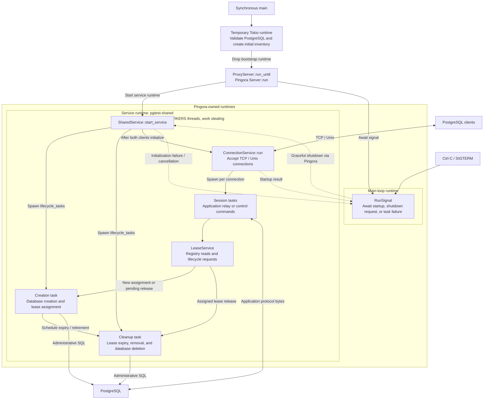

# pgtest-wire-proxy

Handles PostgreSQL client connections over TCP and Unix sockets and supports
pgtest control commands. Application connections use `template/lease-id` as the
database name; the proxy routes each connection to the PostgreSQL database
assigned to that lease and forwards its SQL there.

One Pingora-owned work-stealing runtime hosts creation, cleanup, and all
application/control sessions. `PGTEST_CONNECTION_WORKERS` sets its worker count.
Database clients initialize on this runtime before the listener starts accepting
connections. Failed or cancelled initialization stops the host and closes listeners.

`ProxyServer::run_until` runs Pingora on a synchronous caller's thread and polls
its shutdown future on Pingora's main-loop runtime. The executable uses this
path after dropping its temporary PostgreSQL bootstrap runtime. This is the sole
production hosting entry point; it returns after Pingora shuts down its runtime.
Async hosting helpers are private to the test harness.

For application connections, the proxy rewrites the startup database name and
preserves the client's protocol version and other parameters. It then relays
bytes immediately, including authentication, protocol negotiation, startup errors,
and session parameters. PostgreSQL authenticates the application user directly;
the proxy does not synthesize authentication success or wait for `ReadyForQuery`.
Releasing a lease also closes connections that are still authenticating.

With profiling enabled, `upstream::connect` covers socket connection and
startup submission. Waiting for PostgreSQL's startup response is part of
`relay::run`, so connect timing is not the complete client startup latency.

## Pingora structure

This diagram shows pgtest's Pingora integration. `SharedService` is the single
registered Pingora service. Creation and cleanup are the two async futures stored
in `lifecycle_tasks`; connection sessions are spawned as additional async tasks.
All of them execute on the same service runtime's worker threads.

The accept loop hands each accepted stream to a session task. Application sessions
use a 64 KiB copy buffer per direction; accepted TCP sockets have `TCP_NODELAY` enabled.
Control sessions invoke lease operations rather than relaying SQL to PostgreSQL.

On shutdown, Pingora broadcasts its shutdown watch, sessions stop, and the
lifecycle cancellation token stops creation and cleanup. The host awaits task
cleanup and Pingora shuts down its runtimes before `run_until` returns to `main`.
Startup failures preserve the initialization error; unexpected lifecycle task
exit also requests server shutdown. A lease release acknowledges logical removal
without waiting for the physical database deletion.

Implementation: [services.rs](src/services.rs),
[connection_service.rs](src/connection_service.rs), and
[server main](../../apps/server/src/main.rs).

## Profiling

The existing Hotpath build features provide function, channel, and SQL timings.
Build with `just docker-build-profile` (musl), and stop gracefully to emit the report.
Elapsed async function times include waits and overlap across concurrent tasks;
their totals are not CPU time and can exceed wall time.
